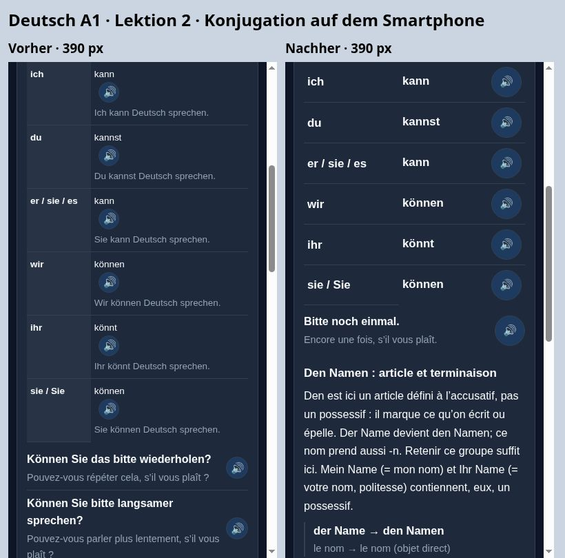

# Deutsch A1: Inhalts- und UX-Audit

Stand: 29. Oktober 2026 (Halifax). Ausgangscommit: `ab02602`.

## A. Tatsächlich geprüfter Umfang

Alle **24 Deutsch-A1-Lektionen**, ihre **50 vorbereiteten Themen** und **60 Seiten im zweiten Reiter** wurden anhand der laufzeitfertigen Inhalte untersucht. Die zusätzlichen zehn Seiten sind vorhandene Grammatikreferenzen; sie wurden mitgezählt. Die Seitenzahl und ihre Reihenfolge bleiben unverändert.

Geprüft wurden `deutsch/deepening-content.js`, `deutsch/study.js`, `deutsch/lesson-flow.js`, die Referenzen in `deutsch/app.js`, die von `deutsch/question-content.js` ergänzten Beispiele, Aussprachehilfen und die tatsächlich injizierten Grundlagen/Vokabeln aus `shared/lesson-foundations.js` und den Vokabelplänen. Die shared-Dateien und die anderen Kurse wurden nicht geändert.

Der Abgleich umfasste die Hörbeispiele derselben Lektion und vorhandene Wiederholungen früherer Lektionen. Beispiele in Lektion 24 sowie die erneut benötigten Formularwörter in Lektion 23 wurden bewusst als Wiederholung erhalten.

## B. Nachgewiesene Probleme

- Jede vorbereitete Einheit zeigte sämtliche vier Satzvarianten plus Zusatzbeispiele. Oft änderte sich nur die Zahl, der Wochentag oder ein Substantiv, während die Grammatik identisch blieb.
- Die letzte vorbereitete Themenseite bekam zusätzlich ältere Referenzsätze und Schreibhilfen angehängt. In Lektion 3 waren das 14 weitere Audiozeilen, darunter bereits anderweitig vorhandene Zahlserien. Auch die Wochentags- und Monatsserie wurden in Lektion 4 doppelt ausgegeben.
- Das automatische Aufteilen einer Regel nach jedem Satz erzeugte viele kleine Absätze und zusätzliche Scrollstrecke.
- Die können-Tabelle enthielt unter jeder Form noch einen nahezu identischen Satz mit Deutsch sprechen. In weiteren Tabellen standen sechs Personen nebeneinander; Audio und Verbform konkurrierten auf schmalen Bildschirmen um Platz.
- Zusätzlich injizierte Übungswortlisten waren ständig ausgeklappt. Acht Zeilen wiederholten dasselbe deutsche Stichwort mit einer anderen französischen Bedeutung, etwa alt → vieux / vieille oder gehören → appartenir / faire partie de.
- Die Serienüberschrift belegte in den zweispaltigen Wortlisten nur eine Spalte. Mehrere Audioflächen waren nur 30–32 Pixel groß.

## C. Umgesetzte Überarbeitung

Die Auswahl `exampleIndices` ist pro Thema redaktionell festgelegt. Eine zusätzliche Sicherung lässt einen nicht ausgewählten Satz nur dann aus der Erklärung weg, wenn **derselbe vollständige Satz im ersten Hörreiter vorhanden ist**. Neue Beispiele werden automatisch erhalten. Es gibt keine Kürzung der Aufgabenpools oder der Hörübungen.

Die Erklärung wird als zusammenhängender Absatz ausgegeben; bei können sind die Formen und die Satzstellung zwei ausdrücklich getrennte Absätze. Alle bisherigen Regeln bleiben wortgleich erhalten, abgesehen von diesem Absatzumbruch.

Die nachfolgende Tabelle zählt sichtbare `.phrase-row`-Beispielzeilen bei geschlossenen Referenzen. Grammatikzellen, einzelne Aussprachetasten und die zusätzlichen Wörter sind eigene Bestandteile und in dieser Spalte nicht enthalten. „Im Hörreiter belassen“ zählt die 91 aus der zweiten Darstellung genommenen Satzvarianten.

| Lektion | Seiten | Sichtbare Beispielzeilen vorher → nachher | Im Hörreiter belassen | Begründung / Erhaltene Lernziele |
|---|---:|---:|---:|---|
| 1. Saluer et se présenter | 6 | 17 → 13 | 4 | Begrüßungen bleiben im Hörreiter; die vier Satzmuster und Fragewörter bleiben sichtbar. sein sowie die regelmäßigen und unregelmäßigen Formen vollständig erhalten. |
| 2. Alphabet et épellation | 2 | 18 → 10 | 3 | S. 2: drei gleich gebaute Können-Sie-Fragen aus der Erklärung genommen; Frage/Aussage, den Namen, das und alle sechs können-Formen erhalten. Sechs wiederholte Vollsätze aus der Tabelle entfernt. Alphabet und alle Sonderzeichen erhalten. |
| 3. Nombres, téléphones et dates | 2 | 26 → 12 | 0 | Keine der sechs gezielten Zahlenkontraste oder Formularbeispiele gekürzt. Zahlserien nicht mehr doppelt aus den Tabellen angehängt; die übrigen älteren Beispiele als Referenz. Alle Ordinalzahl- und Jahresregeln erhalten. |
| 4. Heure et rendez-vous | 4 | 45 → 30 | 5 | Uhrzeiten halb/nach/vor sowie vollständige sieben Wochentage und zwölf Monate erhalten. Reine Uhrzeit- und Terminvarianten reduziert. Die beiden Serien nicht noch einmal am Ende angehängt. |
| 5. Famille et informations personnelles | 4 | 21 → 9 | 3 | mein/meine und Singular/Plural bleiben; Bruder/Schwester/Sohn-Varianten bereits im Hörreiter. Angaben im Formular, sämtliche Possessiv- und haben-Formen erhalten. |
| 6. Manger et boire | 2 | 17 → 9 | 4 | Alle drei Artikelgeschlechter beim Bestellen erhalten. Weitere Produkte mit gleicher Konstruktion im Hörreiter; Rechnung, Speisekarte und Nachbestellung bleiben sichtbar. |
| 7. Achats et prix | 2 | 22 → 11 | 4 | Preisfrage und Mengenangaben erhalten; reine Zahlvarianten reduziert. teuer/klein/groß, Größe, Kasse, Stockwerk und Entscheidung bleiben. |
| 8. Logement et adresse | 3 | 20 → 13 | 1 | Zimmerzahl sowie alle drei Akkusativgeschlechter erhalten. Eine gleich gebaute Suchvariante bleibt im Hörreiter; Besichtigung und Mietfragen erhalten. |
| 9. Ville, itinéraire et transports | 2 | 20 → 10 | 3 | Alle Richtungen und geordnete Wegbeschreibung erhalten. Drei Liniennummernvarianten aus der Erklärung genommen; Umsteigen, Gleis und Verspätung bleiben. |
| 10. Travail et lieu de travail | 3 | 19 → 8 | 5 | im/in der, Beruf und Arbeitszeit bleiben. Weitere Arbeitsorte und Wochentage im Hörreiter; Verspätung, Entschuldigung und frei haben bleiben. Vollständige Verbtabellen erhalten. |
| 11. École et cours de langue | 2 | 22 → 13 | 2 | Zwei reine Tageszeitvarianten reduziert. seit + Präsens, Kursfragen, alle unterschiedlichen Tätigkeiten und die unregelmäßige Form du liest bleiben. |
| 12. Loisirs, sport et week-end | 2 | 22 → 6 | 6 | Sportarten- und Wochentagsvarianten reduziert. gern/lieber, schwimmen und die Verbstellung nach Am Samstag bleiben; Einladung mit Aktivität erhalten. |
| 13. Voyage, hôtel et vacances | 2 | 22 → 8 | 4 | Einzel-/Doppelzimmer, ein/zwei Zimmer und Zeitraum bleiben. Weitere Zimmerart und Abfahrtsstunden im Hörreiter; abfahren/ankommen sowie Dauer erhalten. |
| 14. Santé et médecin | 2 | 21 → 7 | 6 | Zwei Symptommuster plus seit gestern bleiben. Weitere Symptom- und Tagesvarianten im Hörreiter; Termin, Abwesenheit und Gute Besserung erhalten. |
| 15. Invitations et messages courts | 2 | 22 → 7 | 6 | Gleich gebaute Tages- und Mitbringselvarianten reduziert. Vollständige Einladung, Annahme/Absage, Begründung und trennbares mitbringen erhalten. |
| 16. Panneaux, annonces et messages publics | 2 | 21 → 8 | 5 | Handlungsvarianten bei verboten reduziert. Verbot/Einschränkung, geöffnet/geschlossen, Zeitspanne und Zugausfall bleiben. |
| 17. Demandes et réponses polies | 2 | 16 → 9 | 3 | Drei austauschbare Gegenstände aus derselben Bitte im Hörreiter. Bitte um Gegenstand, Hilfe und Erlaubnis sowie alle unterschiedlichen Antwortfunktionen bleiben. |
| 18. Stratégie pour l’examen A1 | 2 | 19 → 11 | 1 | Alle verschiedenen Prüfungsanweisungen erhalten. Nur eine weitere zuerst-Variante aus der Erklärung genommen; Reihenfolge und Textaufbau bleiben. |
| 19. Corps et santé | 2 | 19 → 6 | 7 | Singular tut weh und Plural tun weh bleiben im direkten Vergleich. Weitere Körperteile/Bedarfsobjekte im Hörreiter; Symptomdauer, Arzt, Apotheke und Anweisung erhalten. |
| 20. Météo et vêtements | 3 | 18 → 9 | 4 | Reine Wetteradjektiv- und Gegenstandsvariante reduziert. Zustand/Regen/Schnee, alle Akkusativgeschlechter, mitnehmen und Jahreszeiten bleiben. |
| 21. Loisirs, culture et médias | 2 | 21 → 9 | 6 | Gleich gebaute Ausflugsorte und Konzertzeiten reduziert. lesen/liest, Musik, Vorschlag, Treffpunkt und Eintritt bleiben. |
| 22. Téléphone, messages et technologie | 2 | 19 → 6 | 6 | Tages- und Nachrichtenobjektvarianten reduziert. Rückruf mit trennbarem Verb, Problembeschreibung und vollständiger SMS-Vorschlag bleiben. |
| 23. Services publics, poste et démarches | 2 | 18 → 13 | 0 | Keine gezielten Beispiele gekürzt: unterschiedliche Dokumente, Akkusativformen, Schalterfragen und Formularfelder haben eigenen Lernwert. |
| 24. Révision A1 et langage de l’examen | 3 | 22 → 9 | 3 | Alle wiederholten Vorstellungsfragen bewusst als Abschlusswiederholung erhalten. Nur drei gleich gebaute Wochentagsvarianten reduziert; Nachricht mit Dank und Rückfrage bleibt. |

Es wurden keine weiteren Seiten eingeführt: Die thematischen Grenzen waren bereits vorhanden. Die belegten Überladungen ließen sich durch gezielte Auswahl und eine Trennung von Erklärung und Nachschlagen reduzieren. Bestehende Themen- und Übungsschlüssel, Seitenindizes, Aufgabenanzahlen und Fortschrittswerte bleiben erhalten.

## D. Audio und Vokabeln

- **91 Satzvarianten** erscheinen nicht mehr ein zweites Mal als Grammatikbeispiel. Jeder bleibt vollständig mit Audio im ersten Reiter und in den bisherigen Aufgaben verfügbar. Die genaue Liste je Thema steht in `german-a1-deepening-audit.json`.
- **Fünf exakt doppelte Serien** wurden aus dem angehängten Block genommen: drei Zahlenreihen aus Lektion 3 sowie Wochentage und Monate aus Lektion 4. Sie sind weiterhin im zugehörigen Zahlen-/Wörterbereich mit Audio vorhanden.
- **Sechs wiederholte Vollsätze** unter den können-Formen wurden aus der Tabelle entfernt. Die sechs Pronomen, Formen und Audiotasten bleiben; Frage, Aussage und Infinitivstellung werden weiterhin anhand vollständiger Beispiele geübt.
- **165 weitere Beispielzeilen** bleiben in einer geschlossenen Referenz hinter der Mini-Test-Einstiegsschaltfläche erhalten. Sie wurden wegen unterschiedlicher Wörter oder kommunikativer Funktionen nicht spekulativ gelöscht.
- **112 zusätzliche Wörterzeilen werden als 104 Einträge dargestellt.** Identische deutsche Stichwörter erhalten einen Eintrag und eine Audiotaste; sämtliche französischen Bedeutungen bleiben erhalten. Die Übungswörter sind vor dem Mini-Test unter „Mots pour les exercices“ aufklappbar. Wortdatenbank, Zuordnung zu Aktivitäten und Vokabeltrainer bleiben unverändert.
- Alle sieben Wochentage, zwölf Monate, Zahlenkontraste 13/30 und 28/82, Artikelgeschlechter, Singular/Plural, unterschiedliche Fragen und notwendige unregelmäßige Formen bleiben bewusst sichtbar.

Über alle 60 Seiten sinkt die Anzahl der beim Öffnen sichtbaren Beispielzeilen von **507 auf 246**. Von **846 Audiotasten** in den ursprünglichen Vertiefungsansichten bleiben **473 direkt sichtbar**; weitere **269** sind in den aufklappbaren Wortlisten/Referenzen erreichbar. Die verbleibende Differenz sind die 91 wiederholten Satzzeilen, fünf doppelten Serien und acht zusammengeführten Wörterzeilen. Diese Zahlen beschreiben die Oberfläche, keine Löschung von Lernmaterial oder Audiodateien.

## E. Mobile Darstellung

- können sowie die vorhandenen sein-/haben-Paradigmen werden als sechs Pronomen/Form-Zeilen ausgegeben.
- Vergleichstabellen behalten ihre vollständigen Spalten. Auf Mobilgeräten steht die Audiotaste unter der Form. Die Spaltenüberschrift Pers. hat Personne als vollständige zugängliche Bezeichnung.
- Audioflächen in den betroffenen Beispiel- und Grammatikkomponenten sind 44 × 44 Pixel groß; Themenfortschrittsschaltflächen sind auf Mobilgeräten ebenfalls 44 Pixel hoch.
- Die Serienüberschrift nutzt die ganze Breite. Erklärung, Grammatikübersicht, ausgewählte Beispiele und Übungseinstieg bilden die sichtbare Reihenfolge. Zusatzwörter bleiben vor dem Einstieg zugänglich; ältere Referenzen folgen dahinter.
- Es werden ausschließlich die deutschen Kursdateien gestylt; andere Kurse erhalten keine CSS-Änderung.

Gemessen wurde die Höhe von `#lessonGrammarPage` einschließlich Wortlisten, Aussprachebereich und Mini-Test-Einstieg, bei den regulär geschlossenen Referenzen und der bestehenden Standardskalierung (large, Faktor 1,12):

| Ansicht | 320 px vorher → nachher | 360 px vorher → nachher | 390 px vorher → nachher | Desktop 1024 px vorher → nachher |
|---|---:|---:|---:|---:|
| Lektion 2, S. 2 | 3032 → 1909 px | 2810 → 1754 px | 2685 → 1675 px | 2281 → 1344 px |
| Lektion 3, S. 2 | 4299 → 2149 px | 3911 → 1962 px | 3679 → 1777 px | 3011 → 1369 px |

Bei 320 Pixeln sind diese beiden Bereiche damit etwa **37 % bzw. 50 % kürzer**. Es wurde keine kleinere Schrift als Abkürzung verwendet. Die Werte stammen aus gerenderten Browseransichten und sind von Browser/Schrift abhängig.

## F. Durchgeführte Qualitätskontrolle

1. **Automatische Prüfung aller 24 Lektionen / 60 Seiten:** Erreichbare Reiter, Themenwechsel, Mini-Tests, geschlossene und öffnungsfähige Referenzen, Vokabelzuordnung und gespeicherte Ergebnisse. Dazu fünf neue Regressionstests in `tests/german-deepening-layout.test.cjs`.
2. **Direkter Datenvergleich mit Ausgangscommit:** Alle Hörlisten des ersten Reiters, Eingangsquizfragen, Grammatikaufgaben, Abschlussfragen, ursprünglichen Vokabeln, Tabellen und Regeln stimmen mit `ab02602` überein (nur Leerraum in Regeln normalisiert). Auch Aufgabenschlüssel und Aufgabenanzahlen bleiben gleich.
3. **Browserprüfung:** Alle 60 gerenderten Seiten jeweils bei 320, 360, 390 und 1024 Pixeln; zusätzlich alle 60 Seiten bei diesen vier Breiten mit geöffneten Referenzen und größter unterstützter Textskalierung (larger, Faktor 1,25). In den geprüften 480 Ansichten nach der Änderung wurden keine horizontalen Inhaltsüberläufe gemessen. Ausgewählte Seiten, insbesondere Konjugationsübersichten und die beiden gemeldeten Seiten, wurden zusätzlich visuell betrachtet.
4. **Navigation und Fortsetzen:** Bestehende Tests für Themenwechsel, bereits beantwortete Aufgaben, Punkte, Fortschritt und Fortsetzen bestehen. Die neuen Tests prüfen außerdem die vollständige Erhaltung aller französischen Bedeutungen nach Zusammenführung doppelter Stichwörter.
5. **Gesamtsuite `npm test`:** vorher 415 Tests, davon 395 bestanden und 20 fehlgeschlagen; nachher 420 Tests, davon **400 bestanden und dieselben 20 fehlgeschlagen**. Kein zusätzlicher Fehlername. Zwei bestehende Prüfungen wurden an die neue Darstellung angepasst: Bekanntes Material darf im Hörreiter vermittelt sein, und Referenzdetails dürfen geschlossen bleiben; die eigentlichen Erklärungen sind weiterhin offen. Die Vokabelplatzierungsprüfung erwartet bei deutschen Stichwörtern jetzt die zusammengeführten Einträge.
6. `git diff --check` ohne Beanstandung. Die geänderten Assets sind in `deutsch/index.html` und `deutsch/service-worker.js` auf Version `deepening-layout-178` gesetzt.

Die Browserprüfung verwendete isolierte Ansichten aus den echten Renderfunktionen und denselben Inhaltsdaten/CSS-Dateien. Es wurde kein Benutzerprofil angelegt und keine reale Lernhistorie verändert.

## G. Offene Punkte und Prüfgrenzen

- Die vollständige produktive Anmeldung/Cloud-Synchronisation wurde nicht getestet. Die normale Vorschau zeigt den vorhandenen Anmeldedialog; Inhalts- und Layouttests erfolgten deshalb in isolierten Ansichten derselben Komponenten.
- Audiotexte, Referenzen, Sprachwahl und Abspielaufrufe sind automatisiert geprüft. Die tatsächliche hörbare Sprachausgabe auf Windows, iOS/Safari und unterschiedlichen Geräten ist hier nicht verifiziert.
- Es handelt sich um eine begründete Inhalts-/Darstellungsüberarbeitung, nicht um eine Lernwirksamkeitsstudie mit A1-Anfängern. Es wird keine vollständige linguistische Fehlerfreiheit garantiert.
- Die 20 bereits im Ausgangsstand fehlschlagenden Tests wurden wegen des begrenzten Auftrags nicht über andere Kurse und Funktionen hinweg repariert. Sie betreffen unter anderem Cache-Erwartungen, französische Aufgaben, gespeicherte Reviews, Inventarfingerabdrücke und englische UI-Erwartungen. Die unverändert betroffenen Testnamen folgen zur Nachprüfung.

- new option vocabulary has French meanings before Hard Mode, and offline assets match the page
- German mistake memory, settings, frozen responses and draft position survive reopening
- DE cache loads the question bank before its consumers and shared marking remains opt-in
- all supported pages and offline caches include the reporting module
- all 23 later lessons teach and directly rehearse every existing final-check pattern
- lesson 4 teaches all weekdays, all months, clock distinctions and a complete appointment
- every lesson renders working topic practice without an empty introduction page
- inline answers always play the correct French audio and completion updates the right progress segment
- lesson 3 writing uses five French fields with fictional data, preserves drafts and locks fields during comparison
- reported alphabet questions have natural prompts and task-specific feedback
- surname dictation and writing solution use the same name and ordered French letter audio
- reported preparation tasks use close alternatives and test form labels instead of copied digits
- continue restores the same deepening topic and graded mini-test without duplicate points or audio
- reported avoir and article mini-tests require choosing the actual forms with clear context
- lesson checks use authored vocabulary instead of generating alphabet translation questions
- francais: new lexical data is loaded before both consumers and is cached offline
- deutsch: new lexical data is loaded before both consumers and is cached offline
- reviewed source fingerprints cover all question variants, models and actual recordings in all 48 lessons
- revised French listening questions ask for a request and a usable address detail
- de: English UI and repeated rerendering keep the target language and disabled buttons do not play
- failing tests:

## Veröffentlichungsstand

Die Umsetzung ist auf dem separaten Branch `codex/german-a1-deepening-audit` zur Prüfung gesichert. Die produktive App wurde noch nicht aktualisiert: Die automatische Freigabeprüfung hat den direkten Push auf `main` wegen einer fehlenden ausdrücklichen Freigabe für diesen Schritt abgelehnt. Die nachträgliche Prüfung früherer Anweisungen lieferte keinen eindeutigen Nutzerwortlaut dazu. Der geprüfte Stand kann über den zugehörigen Draft-Pull-Request vor der Übernahme vollständig eingesehen werden.
